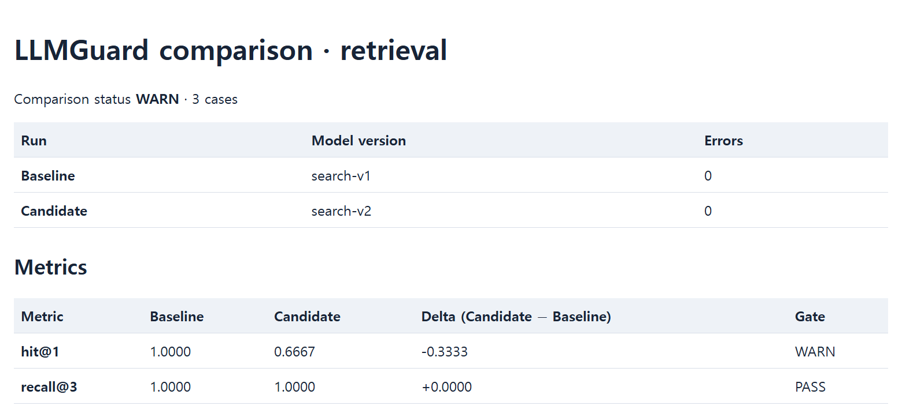
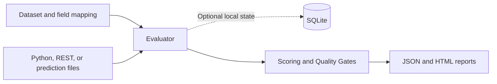

<h1 align="center">LLMGuard CI</h1>

<p align="center"><strong>A local-first regression testing framework for AI systems.</strong></p>

<p align="center">
  Compare AI systems on the same cases, see which results changed, and catch regressions before shipping.
</p>

<p align="center">
  <a href="https://github.com/maxx0214/llmguard-ci/actions/workflows/ci.yml?query=branch%3Arelease%2F0.3.0"></a>
  &nbsp;•&nbsp; Python 3.11–3.13 &nbsp;•&nbsp; <a href="LICENSE">MIT License</a>
</p>

<p align="center">
  <a href="#quick-start">Quick Start</a> &nbsp;·&nbsp;
  <a href="#comparison-report">Report Preview</a> &nbsp;·&nbsp;
  <a href="#integrations">Integrations</a> &nbsp;·&nbsp;
  <a href="#benchmark-validation">Benchmarks</a>
</p>

## Quick Start

From a checkout or extracted source distribution, run:

```bash
python -m pip install .
python examples/quickstart.py
```

The demo compares two local retrievers on three synthetic cases. It runs
without credentials and writes `results/quickstart.json` and
`results/quickstart.html`. It reports `WARN` because the Hit@1 drop falls
between the warning and failure thresholds.

## Comparison report

<a href="docs/examples/comparison.html"></a>

The HTML report shows baseline and candidate scores, per-case changes, and
execution details together. [Download the sample HTML](docs/examples/comparison.html)
and open it in your browser.

## Integrations

### Python SDK

Use a Python callable to evaluate a retriever, language model, or classifier
and turn a Quality Gate failure into a CI failure.

```python
from llmguard import Evaluator, System

cases = [{"id": "q1", "input": "How can I return an order?", "expected": ["returns"]}]
evaluator = Evaluator(
    cases, "retrieval", ["hit@1", "recall@3"],
    quality_gate={"max_drop": {"hit@1": 0.1}},
)
baseline = System(lambda _: ["returns", "shipping"], model_version="search-v1")
candidate = System(lambda _: ["shipping", "returns"], model_version="search-v2")
result = evaluator.compare(baseline, candidate)
result.report("results/search-comparison.json")
raise SystemExit(1 if result.status == "FAIL" else 0)
```

Hit@1 falls from 1 to 0 while Recall@3 stays at 1. The configured Hit@1 gate
returns `FAIL`. Use `min_scores` for an absolute floor, a `warn` and `fail`
mapping for two levels, or `on_unknown` to control how missing measurements
affect the verdict. A saved SDK report can serve as the baseline. See the
[usage guide](docs/usage.md) for async execution, custom metrics, and statistics.

### REST API

Install the REST extra with `python -m pip install ".[rest]"`. The example
expects a service on your machine whose response contains ranked IDs under
`hits`.

```python
from llmguard import Evaluator, RESTAdapter

evaluator = Evaluator("examples/suite/retrieval.jsonl", "retrieval")
with RESTAdapter(
    "http://localhost:8000/search",
    method="POST",
    request_mapping={"query": "input"},
    response_mapping={"retrieved_ids": "hits.*.id"},
    timeout=3,
) as search:
    evaluator.evaluate(search).report("results/service.json")
```

For an authenticated service, use HTTPS and map header names to environment
variables with `auth_headers`. REST calls send the mapped input fields to the
configured endpoint.

### Saved predictions

```python
from llmguard import Evaluator, PredictionFile

evaluator = Evaluator("examples/suite/retrieval.jsonl", "retrieval", ["hit@1", "mrr@3"])
result = evaluator.compare(
    PredictionFile("examples/suite/baseline.jsonl"),
    PredictionFile("examples/suite/candidate.jsonl"),
)
result.report("results/archived-comparison.json")
```

JSON, JSONL, and CSV files are joined by case ID; duplicate, missing, and
unexpected IDs are rejected. Use `dataset_mapping` and `prediction_mapping`
to read fields such as `gold_chunks.*.chunk_id` from an existing export.
Replaying a file makes zero model calls.

## Architecture



The SDK supports retrieval, lexical question-answering, and classification.
Optional paired inference provides bootstrap confidence intervals,
permutation or McNemar tests, and Holm or Bonferroni correction.
Generic SDK reports omit inputs, gold values, and predictions by default.
Use opaque case IDs and metadata. Keep SQLite state private because normalized
predictions are stored there. Legacy suite and BANKING77 reports include case
payloads. See the [data-handling notes](docs/usage.md#data-handling).

## Benchmark validation

| Dataset | Scope | Agreement with reference scorer |
| --- | --- | --- |
| SQuAD v1.1 | 100 validation questions, seed 42, two saved QA runs | Exact match and token F1 agreed within floating-point precision (maximum absolute difference below `2e-16`, on a 0–1 scale). |
| BEIR NFCorpus | 323 test queries, 3,633 documents, BM25 and dense rankings at K = 1, 3, 5, 10 | Hit, Recall, MRR, and nDCG agreed within the reference tool's five-decimal rounding (maximum absolute difference below `5e-6`). |

Identical predictions passed the regression gate. An intentionally degraded
QA variant and a truncated BM25 control failed it. These checks validate the
scoring and comparison paths on the recorded runs. See the
[benchmark methods and replay commands](docs/benchmarks.md).

In an archived **Turini RAG** integration, the SDK replayed two retrieval
versions over 157 cases and reproduced all 16 previously measured retrieval
scores on both sides and the paired statistics. The run used saved rankings
with a candidate pool of 50 and made zero model API calls.

## Documentation and support

The core package has no third-party runtime dependencies. Install extras for
REST, statistics, OpenAI, YAML, BANKING77, public benchmarks, and development
tools as needed. The test workflow runs without model credentials.

| Guide | What it covers |
| --- | --- |
| [Usage](docs/usage.md) | SDK, mappings, caching, statistics, and data handling |
| [Benchmarks](docs/benchmarks.md) | Public datasets, scoring methods, and replay instructions |
| [Contributing](CONTRIBUTING.md) | Local development, tests, and package checks |
| [Changelog](CHANGELOG.md) | Release history |
| [Releasing](docs/releasing.md) | Build verification and publication |
