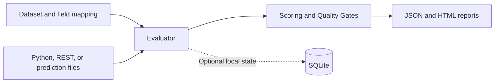

# LLMGuard CI

**A local-first regression testing framework for AI systems.**

Use the same cases to compare two versions of a retriever, language model, or
classifier. LLMGuard CI scores both versions, identifies which cases changed,
and applies a Quality Gate you define. It runs in your environment and can
evaluate archived predictions without contacting a model.

## Quick Start

From a checkout or extracted source distribution, with Python 3.11–3.13:

```bash
python -m pip install .
python examples/quickstart.py
```

The example compares two local retrieval functions on three synthetic cases.
It prints `WARN` because Hit@1 drops by one-third, between the configured warning
and failure bounds. It writes `results/quickstart.json` and a single HTML report.
Download and open the [generated HTML example](docs/examples/comparison.html)
locally to see both sides, their deltas, and the affected cases.

## Python SDK and Quality Gates

```python
from llmguard import Evaluator, System

cases = [{"id": "q1", "input": "How can I return an order?", "expected": ["returns"]}]
evaluator = Evaluator(
    cases, "retrieval", ["hit@1", "recall@3"],
    quality_gate={"max_drop": {"hit@1": 0.1}},
)
baseline = System(lambda _: ["returns", "shipping"], model_version="search-v1")
candidate = System(lambda _: ["shipping", "returns"], model_version="search-v2")
result = evaluator.compare(baseline, candidate)
result.report("results/search-comparison.json")
raise SystemExit(1 if result.status == "FAIL" else 0)
```

Hit@1 falls from 1 to 0 while Recall@3 stays at 1. The configured Hit@1 gate
returns `FAIL`. Use `min_scores` for an absolute floor, a `warn` and `fail`
mapping for two levels, or `on_unknown` to control how missing measurements
affect the verdict. A saved SDK report can serve as the baseline. See the
[usage guide](docs/usage.md) for async execution, custom metrics, and statistics.

## REST API

Install `python -m pip install ".[rest]"`. This example expects a service
running on your machine and a response with ranked IDs under `hits`.

```python
from llmguard import Evaluator, RESTAdapter

evaluator = Evaluator("examples/suite/retrieval.jsonl", "retrieval")
with RESTAdapter(
    "http://localhost:8000/search",
    method="POST",
    request_mapping={"query": "input"},
    response_mapping={"retrieved_ids": "hits.*.id"},
    timeout=3,
) as search:
    evaluator.evaluate(search).report("results/service.json")
```

For an authenticated service, use HTTPS and map header names to environment
variables with `auth_headers`. REST calls send the mapped input fields to the
configured endpoint.

## Archived predictions

```python
from llmguard import Evaluator, PredictionFile

evaluator = Evaluator("examples/suite/retrieval.jsonl", "retrieval", ["hit@1", "mrr@3"])
result = evaluator.compare(
    PredictionFile("examples/suite/baseline.jsonl"),
    PredictionFile("examples/suite/candidate.jsonl"),
)
result.report("results/archived-comparison.json")
```

JSON, JSONL, and CSV files are joined by case ID; duplicate, missing, and
unexpected IDs are rejected. Use `dataset_mapping` and `prediction_mapping`
to read fields such as `gold_chunks.*.chunk_id` from an existing export.
Replaying a file makes zero model calls.

## Architecture



The SDK supports retrieval, lexical question-answering, and classification.
Optional paired inference provides bootstrap confidence intervals,
permutation or McNemar tests, and Holm or Bonferroni correction.
Generic SDK reports omit inputs, gold values, and predictions by default.
Use opaque case IDs and metadata. Keep SQLite state private because normalized
predictions are stored there. Legacy suite and BANKING77 reports include case
payloads. See the [data-handling notes](docs/usage.md#data-handling).

## Validation

| Dataset | Scope | Agreement with reference scorer |
| --- | --- | --- |
| SQuAD v1.1 | 100 validation questions, seed 42, two saved QA runs | Exact match and token F1 agreed within floating-point precision (maximum absolute difference below `2e-16`, on a 0–1 scale). |
| BEIR NFCorpus | 323 test queries, 3,633 documents, BM25 and dense rankings at K = 1, 3, 5, 10 | Hit, Recall, MRR, and nDCG agreed within the reference tool's five-decimal rounding (maximum absolute difference below `5e-6`). |

Identical predictions passed the regression gate. An intentionally degraded
QA variant and a truncated BM25 control failed it. These checks validate the
scoring and comparison paths on the recorded runs. See the
[benchmark methods and replay commands](docs/benchmarks.md).

In an archived **Turini RAG** integration, the SDK replayed two retrieval
versions over 157 cases and reproduced all 16 previously measured retrieval
scores on both sides and the paired statistics. The run used saved rankings
with a candidate pool of 50 and made zero model API calls.

## Support and contributing

LLMGuard CI is tested on Python 3.11, 3.12, and 3.13. The core package has no
third-party runtime dependencies. Install `[rest]`, `[statistics]`,
`[openai]`, `[yaml]`, `[banking77]`, `[benchmarks]`, or `[dev]` as needed.
The test workflow runs with no model credentials.

[MIT license](LICENSE) · [Contributing](CONTRIBUTING.md) ·
[Changelog](CHANGELOG.md) · [Maintainer release guide](docs/releasing.md)
